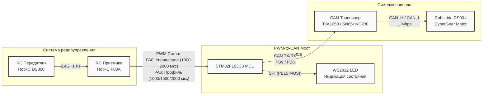

# RobStride PWM-to-CAN Bridge

Мост для управления сервоприводом ROBSTRIDE 00 через стандартный PWM-сигнал от RC-аппаратуры. Проект реализован на микроконтроллере STM32F103C8 и выступает промежуточным звеном между приемником и контроллером мотора по шине CAN.

## О проекте
Основная цель разработки — создание надежного встроенного программного обеспечения с упором на отказоустойчивость, детерминизм и безопасное взаимодействие с аппаратной частью. Система не просто транслирует сигналы, но и активно контролирует телеметрию, защищая привод от выхода из строя при аварийных ситуациях.

## Архитектура системы
Проект рализует надежный мост между аппаратурой радиоуправления и интеллектуальным сервоприводом. Ниже представлена схема взаимодействия компонентов и потоков данных.




## Ключевые особенности 
Система управляется строгим конечным автоматом, который обеспечивает чистые переходы между состояниями инициализации, самотестирования, штатной работы и обработки ошибок.

Для захвата ШИМ-сигналов используется аппаратный режим PWM Input в связке с Slave Reset Mode и встроенным фильтром. Это позволяет аппаратуре микроконтроллера самостоятельно отсекать дребезг контактов и электрические наводки до того, как данные попадут в программный обработчик.

Чтение телеметрических данных, таких как температура и момент, из прерывания организовано через критические секции. Такой подход гарантирует атомарность операций и полностью исключает риск получения "рваных" или неполных данных в основном цикле программы.

Мониторинг напряжения шины и позиции вала во время работы выполняется асинхронно. Это позволяет сохранить основной цикл управления полностью неблокирующим, избегая джиттера и задержек при отправке команд.
Механизм обработки ошибок разделяет сбои на критические и восстанавливаемые. Система различает жесткие отказы, такие как потеря питания или сигнала, и мягкие, например перегрев. Внедрен механизм сброса счетчика ошибок после периода стабильной работы, что предотвращает бесконечные циклы перезапуска при кратковременных помехах.

В целях оптимизации использования стека и предотвращения аппаратных сбоев на ресурсоограниченном микроконтроллере, тяжелые функции форматирования строк были полностью исключены из критических путей выполнения в пользу легкой побайтовой передачи данных.

## Стек технологий и оборудование
Проект написан на языке C с использованием фреймворков STM32 HAL и CMSIS. Для сборки и отладки применяются PlatformIO в среде VS Code, STM32CubeMX и логический анализатор. Взаимодействие с периферией организовано через протоколы CAN 2.0B, PWM Input Capture, SPI и UART.

Аппаратная часть включает плату STM32F103C8, сервопривод ROBSTRIDE RS00, RC-приемник с PWM-выходом, CAN-трансивер и адресный светодиод WS2812 для визуальной индикации состояний системы.

## Логика работы системы
При включении питания система переходит в фазу инициализации. Она опрашивает шину CAN для поиска привода, сбрасывает сохраненные ошибки и проверяет, что напряжение питания и температура находятся в безопасных пределах.

Далее запускается автоматическое самотестирование. Привод отрабатывает заранее заданную последовательность движений, что позволяет подтвердить механическую исправность и стабильность связи перед началом полноценной работы.
После успешного тестирования система переходит в штатный режим. Основной цикл частотой 100 Гц считывает отфильтрованные значения ШИМ, вычисляет целевой угол и отправляет команды синхронного позиционирования. Параллельно в фоновом режиме непрерывно анализируется телеметрия.

При выходе любых параметров за установленные границы привод немедленно обесточивается. В зависимости от типа ошибки система либо предпринимает попытки автоматического восстановления, либо переходит в режим жесткой блокировки, требующий ручного вмешательства.


## Назначение
Проект демонстрирует навыки разработки надежного встроенного ПО (Bare-metal/HAL) с акцентом на отказоустойчивость, детерминизм и безопасную работу с железом. Устройство преобразует ШИМ-сигналы в команды протокола RobStride/CyberGear, контролируя телеметрию и защищая привод от аварийных режимов.

## Ключевые особенности (Hardened Design)
- **Конечный автомат (FSM):** Четкое разделение состояний: `INIT` → `SELFTEST` → `OPERATION` → `FAULT`.
- **Безопасный захват ШИМ:** Использование режима `PWM Input` с `Slave Reset Mode` и аппаратным фильтром (IC Filter = 8) для подавления дребезга и наводок.
- **Атомарная работа с данными:** Чтение телеметрии (температура, момент) из ISR выполняется через критические секции (`__disable_irq()`), исключая "рваные" данные (torn reads).
- **Неблокирующая архитектура:** Опрос напряжения (VBUS) и позиции вала в режиме `OPERATION` выполняется асинхронно, не блокируя основной цикл управления (CSP) и не создавая джиттер.
- **Защита от "шторма" ошибок:** Разделение ошибок на "жесткие" (Hard Fault, потеря PWM, критическое напряжение) и "мягкие" (перегрев). Реализован механизм budget reset для предотвращения бесконечных циклов перезапуска.
- **Оптимизация ресурсов:** Отказ от тяжелых функций форматирования (`snprintf`) в критических путях для экономии стека и предотвращения Hard Fault.

## 🛠️ Стек технологий
- **Язык:** C (C11)
- **Микроконтроллер:** STM32F103C8T6 (ARM Cortex-M3)
- **Фреймворк:** STM32 HAL, CMSIS
- **Инструменты:** STM32CubeMX, PlatformIO (VS Code), Logic Analyzer
- **Протоколы:** CAN 2.0B (1 Мбит/с, ABOM), PWM Input Capture, SPI (для WS2812), UART (отладка)

## 📦 Используемое оборудование
- STM32F103C8 "Blue Pill"
- Сервопривод ROBSTRIDE RS00 (или совместимый CyberGear)
- RC-приемник HotRC (или любой с PWM-выходом)
- CAN-трансивер (TJA1050 / SN65HVD230)
- Адресная светодиодная лента WS2812 (для индикации состояния)

## 🏗️ Архитектура и логика работы
1. **INIT:** Поиск привода по CAN, сброс ошибок, первичная проверка телеметрии (VBUS > 28В, температура в норме).
2. **SELFTEST:** Автоматическая проверка хода привода (0° → +50° → -50° → 0°) в режиме Position Control с контролем достижения целевой точки.
3. **OPERATION:** Переход в режим Cyclic Synchronous Position (CSP). Основной цикл (100 Гц) читает отфильтрованный PWM, рассчитывает целевой угол и отправляет команду. Параллельно мониторится телеметрия.
4. **FAULT:** При аварии привод обесточивается (`STOP`). Система пытается восстановиться (для мягких ошибок) или уходит в жесткую блокировку (красный LED) до перезагрузки.

## 🚀 Сборка и прошивка
Проект настроен для сборки через PlatformIO.

1. Установите [PlatformIO IDE](https://platformio.org/) в VS Code.
2. Клонируйте репозиторий:
   ```bash
   git clone https://github.com/YarValerievich/robstride_pwm_bridge.git
   cd robstride_pwm_bridge