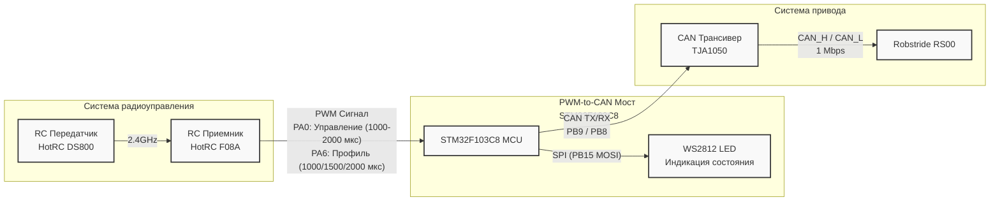

# RobStride PWM-to-CAN Bridge

Мост для управления сервоприводом ROBSTRIDE 00 через стандартный PWM-сигнал от RC-аппаратуры. Проект реализован на микроконтроллере STM32F103C8 и выступает промежуточным звеном между приемником и контроллером мотора по шине CAN.

## О проекте
Основная цель разработки — создание надежного встроенного программного обеспечения с упором на отказоустойчивость, детерминизм и безопасное взаимодействие с аппаратной частью. Система не просто транслирует сигналы, но и активно контролирует телеметрию, защищая привод от выхода из строя при аварийных ситуациях.

## Архитектура
Проект рализует надежный мост между аппаратурой радиоуправления и интеллектуальным сервоприводом. Ниже представлена схема взаимодействия компонентов и потоков данных.

## Ключевые особенности 
Система управляется строгим конечным автоматом, который обеспечивает чистые переходы между состояниями инициализации, самотестирования, штатной работы и обработки ошибок.

Для захвата ШИМ-сигналов используется аппаратный режим PWM Input в связке с Slave Reset Mode и встроенным фильтром. Это позволяет аппаратуре микроконтроллера самостоятельно отсекать дребезг контактов и электрические наводки до того, как данные попадут в программный обработчик.

Чтение телеметрических данных, таких как температура и момент, из прерывания организовано через критические секции. Такой подход гарантирует атомарность операций и полностью исключает риск получения "рваных" или неполных данных в основном цикле программы.

Мониторинг напряжения шины и позиции вала во время работы выполняется асинхронно. Это позволяет сохранить основной цикл управления полностью неблокирующим, избегая джиттера и задержек при отправке команд.
Механизм обработки ошибок разделяет сбои на критические и восстанавливаемые. Система различает жесткие отказы, такие как потеря питания или сигнала, и мягкие, например перегрев. Внедрен механизм сброса счетчика ошибок после периода стабильной работы, что предотвращает бесконечные циклы перезапуска при кратковременных помехах.

В целях оптимизации использования стека и предотвращения аппаратных сбоев на ресурсоограниченном микроконтроллере, тяжелые функции форматирования строк были полностью исключены из критических путей выполнения в пользу легкой побайтовой передачи данных.

## Стек технологий и оборудование
Проект написан на языке C с использованием фреймворков STM32 HAL и CMSIS. Для сборки и отладки применяются PlatformIO в среде VS Code, STM32CubeMX и логический анализатор. Взаимодействие с периферией организовано через протоколы CAN 2.0B, PWM Input Capture, SPI и UART.

Аппаратная часть включает плату STM32F103C8, сервопривод ROBSTRIDE RS00, RC-приемник с PWM-выходом, CAN-трансивер и адресный светодиод WS2812 для визуальной индикации состояний системы.

## Логика работы системы
При включении питания система переходит в фазу инициализации. Она опрашивает шину CAN для поиска привода, сбрасывает сохраненные ошибки и проверяет, что напряжение питания и температура находятся в безопасных пределах.

Далее запускается автоматическое самотестирование. Привод отрабатывает заранее заданную последовательность движений, что позволяет подтвердить механическую исправность и стабильность связи перед началом полноценной работы.
После успешного тестирования система переходит в штатный режим. Основной цикл частотой 100 Гц считывает отфильтрованные значения ШИМ, вычисляет целевой угол и отправляет команды синхронного позиционирования. Параллельно в фоновом режиме непрерывно анализируется телеметрия.

При выходе любых параметров за установленные границы привод немедленно обесточивается. В зависимости от типа ошибки система либо предпринимает попытки автоматического восстановления, либо переходит в режим жесткой блокировки, требующий ручного вмешательства.
